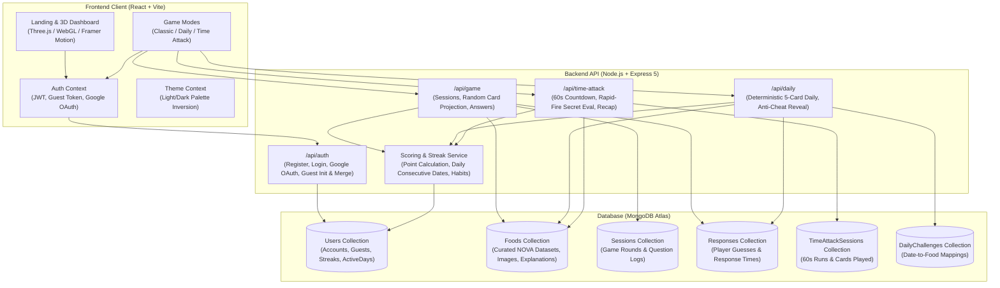

# 🧪 IngredientIQ

[](https://nodejs.org/)
[](https://reactjs.org/)
[](https://vitejs.dev/)
[](https://www.mongodb.com/)
[](https://tailwindcss.com/)
[](https://cosylab.iiitd.edu.in/ingredient-iq)

> **Live Deployment:** [https://cosylab.iiitd.edu.in/ingredient-iq](https://cosylab.iiitd.edu.in/ingredient-iq)  
> **Developed by:** Dhruv Dagar, Dhruv Tanwar, and Shaffil Saini (IIIT-Delhi Cosy Lab Project).

---

## 📖 About the Game

**IngredientIQ** is an interactive, educational food-literacy web game where players inspect realistic consumer food products, examine real-world ingredient lists, and guess the product's **NOVA Food Processing Level (1 to 4)**.

Most consumers struggle to distinguish between minimally processed foods and industrial ultra-processed formulations loaded with emulsifiers, cosmetic additives, and added sugars. IngredientIQ gamifies food awareness, helping players recognize healthy vs. ultra-processed foods through rapid card-based gameplay, habit-building streaks, and daily challenges.

### The NOVA Classification Framework
The game is built upon the internationally recognized **NOVA Food Classification System** (developed by the Center for Epidemiological Studies in Health and Nutrition, University of São Paulo, Brazil):

* **Level 1 — Unprocessed or Minimally Processed Foods:**  
  Natural agricultural products in their whole form or subjected to cleaning, boiling, pasteurization, or freezing without added substances (e.g., fresh fruit, oats, plain milk, eggs, raw nuts, plain grains).
* **Level 2 — Processed Culinary Ingredients:**  
  Substances extracted directly from nature or Level 1 foods used in cooking (e.g., olive oil, butter, salt, cane sugar, vinegar).
* **Level 3 — Processed Foods:**  
  Simple products manufactured by combining Level 1 foods with Level 2 ingredients, typically preserved in salt, oil, or sugar (e.g., canned tuna in oil, freshly baked artisanal sourdough bread, cheeses, salted roasted nuts).
* **Level 4 — Ultra-Processed Food and Drink Products (UPFs):**  
  Industrial formulations containing 5+ ingredients rarely found in domestic kitchens, including flavor enhancers, colorings, artificial sweeteners, emulsifiers, modified starches, and hydrogenated oils (e.g., sodas, packaged snack chips, mass-market packaged breads, instant noodles, reconstituted meat).

---

## 🎮 Game Modes & How to Play

### 1. Instant Anonymous Onboarding
* **Zero Barrier to Play:** New visitors can start playing instantly without an upfront login prompt.
* **Database-Backed Guest Sessions:** Points, answered questions, and streak records are securely saved to anonymous sessions in MongoDB from Card #1.
* **1-Click Google Sign-In Merge:** When a player starts a streak, a non-intrusive soft banner invites them to save their progress across devices. All guest scores, session logs, and daily streaks automatically merge into their permanent account without data loss.

### 2. Classic Endless Mode (`/game`)
* 10-card rounds using an interactive 3D playing-card interface.
* Inspect product names, brand, and clean indexed ingredient lists with click-to-zoom overlays.
* Guess the NOVA processing group (1–4) and receive instant feedback, score changes, and nutritional explanations.

### 3. Daily Challenge (`/daily`)
* A LeetCode-style daily puzzle with **5 curated questions** identical for all players globally each calendar day.
* Answers and explanations are cryptographically withheld from the client until each question is submitted to prevent network inspection cheating.
* Contributes to the player's daily active play streak.

### 4. Time Attack Blitz Mode (`/time-attack`)
* A high-intensity **60-second speed run**!
* Rapid-fire card flips: answer as many cards as possible within 1 minute.
* Answers are hidden during the run to maintain flow and momentum.
* Comprehensive endgame report showing total attempted, accuracy percentage, points earned, and card-by-card breakdown.

### 5. Scoring & Tier System
* **+10 Points** for every correct classification.
* **-2 Points** penalty for incorrect classifications once reaching Level 4 (Mastery Stakes).
* **Player Tiers:**
  * 🌱 **Novice** (0 – 199 PTS)
  * 🍳 **Apprentice** (200 – 399 PTS)
  * 👨‍🍳 **Expert** (400 – 599 PTS)
  * 👑 **Master** (600+ PTS)
* **Habit & Streak Tracking:** Consecutive calendar-day tracking (🔥) integrated with an interactive visual habit calendar.

---

## 🏛️ System Architecture

IngredientIQ follows a decoupled, service-oriented MERN architecture:



---

## 🛠️ Tech Stack

### Frontend (`client/`)
* **Framework:** React 18, Vite 5, TypeScript & JSX
* **Styling & Theme:** Tailwind CSS v4, dynamic cream/navy dual-palette with light/dark contrast guard
* **3D & Animations:** Three.js, WebGL liquid glass shaders, Framer Motion for card physics and carousels
* **Authentication:** `@react-oauth/google` (Google Identity Services) & JWT LocalStorage sync
* **Routing:** React Router DOM v6 with protected and guest-compatible route guards

### Backend (`server/`)
* **Runtime & Framework:** Node.js (CommonJS), Express.js 5
* **Database & ODM:** MongoDB Atlas, Mongoose 8/9
* **Authentication & Security:** JSON Web Tokens (`jsonwebtoken`), `bcrypt` password hashing, Google Auth Library (`google-auth-library`)
* **Scoring & Streak Engine:** Deterministic calendar-date comparisons (`YYYY-MM-DD`), penalty thresholds, and batch merge utilities
* **Anti-Cheat Design:** Answer fields (`novaGroup`, `explanationText`) are stripped on the server side until response submission

### Data & Content (`data/`, `server/src/scripts/`)
* **Food Database:** Curated nutritional snapshots derived from Open Food Facts with manual verification.
* **Automated Ingestion Scripts:** Automated scrapers, clean-up tools (`cleanNames.js`), inventory dumpers (`dumpInventory.js`), image fetchers (`fetchImages.js`), and explanation generators (`generateExplanations.js`).

---

## 📂 Project Structure

```text
IngredientIQ/
├── client/                           # React frontend application
│   ├── src/
│   │   ├── components/               # Core UI components
│   │   │   ├── Game.jsx              # Classic 10-card game mode
│   │   │   ├── DailyChallenge.jsx    # 5-card daily challenge
│   │   │   ├── TimeAttack.jsx        # 60s rapid-fire blitz mode
│   │   │   ├── Landing.jsx           # Public landing & onboarding page
│   │   │   ├── Login.jsx             # Traditional & Google auth
│   │   │   ├── Register.jsx          # New user registration
│   │   │   ├── game/                 # 3D game dashboard & transitions
│   │   │   └── ui/                   # Reusable components (StreakButton, ThemeToggle, CardPack)
│   │   ├── context/                  # State management (Auth, Theme, StreakNotification)
│   │   ├── lib/                      # Game mode configs, math helpers, ingredient parsers
│   │   ├── App.jsx                   # Route declarations
│   │   └── index.css                 # Custom design tokens & global CSS
│   ├── package.json
│   └── vite.config.js
│
├── server/                           # Express.js REST API
│   ├── src/
│   │   ├── config/                   # MongoDB connection configuration
│   │   ├── middleware/               # JWT authentication middleware
│   │   ├── models/                   # Mongoose Schemas (User, Food, Session, Response, DailyChallenge, TimeAttackSession)
│   │   ├── routes/                   # API Endpoints (authRoutes, gameRoutes, dailyRoutes, timeAttackRoutes)
│   │   ├── services/                 # Business logic (scoringService, streakService)
│   │   ├── scripts/                  # Data curation & ingestion utilities
│   │   └── test/                     # Unit and live E2E integration test suites
│   ├── package.json
│   └── server.js                     # Express application entrypoint
│
├── data/                             # Raw food records & curation CSVs
└── README.md
```

---

## 🚀 Local Development Setup

### 1. Prerequisites
* **Node.js:** v18.0.0 or higher
* **npm:** v9.0.0 or higher
* **MongoDB:** Local MongoDB instance or free MongoDB Atlas URI

### 2. Clone the Repository
```bash
git clone https://github.com/dhruv-dagar/IngredientIQ.git
cd IngredientIQ
```

### 3. Backend Setup
```bash
cd server
npm install
```

Create a `.env` file in the `server/` directory:
```env
PORT=5001
MONGO_URI=mongodb+srv://<username>:<password>@cluster0.ujkgfjo.mongodb.net/ingredientiq?retryWrites=true&w=majority
JWT_SECRET=your-secure-jwt-secret-here
GOOGLE_CLIENT_ID=your-google-oauth-client-id.apps.googleusercontent.com
```

Start the backend development server:
```bash
npm run dev
# Server will run on http://localhost:5001
```

### 4. Frontend Setup
In a new terminal window:
```bash
cd client
npm install
```

Create a `.env` file in the `client/` directory:
```env
VITE_GOOGLE_CLIENT_ID=your-google-oauth-client-id.apps.googleusercontent.com
```

Start the Vite development server:
```bash
npm run dev
# Frontend will run on http://localhost:5173
```

Open your browser and navigate to `http://localhost:5173`.

---

## 🧪 Testing

The backend includes automated unit and integration tests:

```bash
cd server

# Run scoring service unit tests
node src/services/scoringService.test.js

# Run Time Attack unit tests
node src/test/timeAttack.test.js

# Run Streak service unit tests
node src/test/streakService.test.js

# Run live E2E Streak API integration test
node src/test/testStreakApi.js

# Run live E2E Anonymous Guest & Account Merge test
node src/test/testGuestAndMerge.js
```

---

## 👥 Contributors & Roles

| Contributor | Role | Core Responsibilities |
| :--- | :--- | :--- |
| **Dhruv Dagar (Person B)** | Backend, Database & Deployment | Food/session/response schemas, REST APIs, Google OAuth, scoring/streak engine, guest account migration, hosting |
| **Dhruv Tanwar (Person A)** | Frontend & Game UX | 3D visual dashboard, responsive gameplay screens, habit calendar, dark/light theme, card zoom & animations |
| **Shaffil Saini (Person C)** | Data, Research & Testing | NOVA dataset curation, Open Food Facts ingestion, classification validation, user testing & methodology |

---

## 📄 License
This project is developed for educational and academic research purposes under the **IIIT-Delhi Cosy Lab**. All food product metadata and imagery are attributed to [Open Food Facts](https://world.openfoodfacts.org/) under the Open Database License (ODbL).
